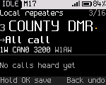
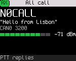
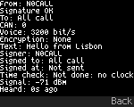
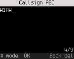
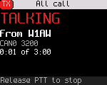
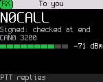
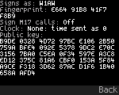
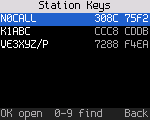
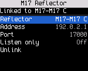
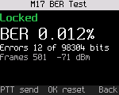

<!-- SPDX-License-Identifier: MIT -->
<!-- Copyright (c) 2026 The RadioFoundry Authors -->

# M17

M17 is an open digital voice and data mode for amateur radio. Stations are known by their callsign, not a number.
Voice uses the open Codec 2 codec, so M17 needs no codec from the stock firmware.

Not every radio runs M17, and not every build has every part of it (signatures, encryption, SMS, the heard list, the
BER test): [M17 on each radio](23-radios.md#m17-on-each-radio) and the [feature matrix](../feature-matrix.md) say
which. M17 has not yet been tried against another M17 radio or hotspot.

Program M17 channels, your callsign, keys and station keys in the Codeplug Editor ([Programming the
radio](04-programming.md#m17)). On the radio you can also set the callsign, the call text, the CAN and the voice rate.

## Your callsign

PTT on M17 needs your callsign. Without one the radio says **No M17 callsign set**; press **OK** there to type it.
You can also set it in **Settings > My radio > M17 callsign**. If the codeplug's radio name is a valid callsign,
it is used until you set one.

- A callsign has up to 9 characters: A-Z, 0-9, `-`, `/` and `.`. Key **1** types `- / .`, **0** a space.
- It must start with a letter or a digit.
- **M17 call text** (My radio) is sent with every call, up to 52 characters.

## M17 channels and the VFO

| Where | How |
|---|---|
| A stored M17 channel | From the Codeplug Editor, a shared zone, or any channel: press **OK** on its **Mode** until it says M17, then save ([Editing a channel](07-channels-zones-vfo.md#editing-a-channel)) |
| The VFO | **\***, **4** steps the VFO's mode: FM, DMR, then P25, NXDN and M17 on a radio that runs them ("VFO: M17") ([M17 in the VFO](07-channels-zones-vfo.md#m17-in-the-vfo)) |

The VFO and a new M17 channel start with **Settings > Talk & listen > M17 CAN** and **M17 voice**, the destination
**All call** and encryption off.

### CAN

The channel access number (CAN, 0-15) keeps groups apart on one frequency, as a color code does on DMR. The radio
plays calls on its channel's CAN. **Digital monitor** (Quick **5**) plays calls on every CAN. A channel's CAN can
also be **Any** (received calls on every CAN, sent on its own). Calls on another CAN show **Other CAN: not played**.

### Voice rate

**3200 bit/s** is full-quality voice. **1600 bit/s + data** halves the voice rate to leave room for data in the
stream; this radio sends no data in it, and data it receives there is not shown.

## Home and calls

| Where | Shows |
|---|---|
| Talk line | The destination: **All call** or a callsign |
| Chips | Power, `CAN0 3200` (the channel access number and the voice rate), **Priv** when the channel encrypts, **Sig** when you sign calls, your callsign |
| Receiving | The caller large, then the destination ("To you" when it is you), "via" a repeater or reflector, the call text, the distance (with your GPS fix) and the signature's word |
| After a call | The last caller and its signature's word. **#**, **3** opens **Call Details** |

A call the radio doesn't play says why: **Encrypted: not played**, **Scrambled: not played**, **Other CAN: not
played** or **Data only: no voice**.

**Call Details** shows the last call in full: who called and to whom, the CAN, the voice rate, the call text, the
position, and for a signed call the signer, when it was signed and the time check.

### Signatures

A signed call proves which station sent it. The radio checks the signature at the end of the call against the
sender's public key in your **station keys**.

| Word | Meaning |
|---|---|
| Sig OK | The signature matches the sender's key |
| Sig failed | It doesn't match. A banner says so; **#** opens the details |
| By W1AW | Signed by another station than the one that called. A banner says so. Recent says "Other signer" |
| Old | The signature matches, but the radio's clock puts it more than 5 minutes off |
| Repeat | The signature matches a call the radio accepted before: a recording played again |
| Signed: no key to check | You don't hold the sender's key |
| Not checked: joined late | You joined after the call started |
| Not checked: frames lost | Part of the call was lost, so the signature can't be checked |
| Checking | The call has ended and the radio is checking. It takes a moment |
| Not signed | An unsigned call from a station whose key you hold |

Unsigned calls from stations whose key you don't hold show no word: most M17 calls are unsigned.

**When was it signed.** The radio keeps no clock across power off. It knows the time only from a GPS fix (or from a
computer that set it). Then **Call Details** says **In time** or **Too old** for the signature's time. Without a
clock it never calls a signed call recent or old: **Time check: Not done: no clock**. A sender without a clock sends
no time: **Signed at: Not sent**.

To sign your calls, turn on **Settings > Privacy > Sign M17 calls**. It needs a signing key from the Codeplug Editor.
**M17 signing key** shows its fingerprint; compare it with the editor's. **M17 station keys** lists the keys you hold.
A shared zone never brings a station key or a signing key: anyone can send a zone, so the radio trusts only keys you
added in the Codeplug Editor. Signing hides nothing, so it is allowed on amateur bands. It adds a short tail to the
end of each call.

### Encryption

An M17 channel can encrypt its calls with the scrambler or AES, with a key from the Codeplug Editor. The channel
editor's **Encryption** turns it on or off; the key and its type are the editor's. A channel that encrypts shows
**Priv** on Home, and **Privacy** (Quick **6**) turns it off. The radio plays an encrypted call only with the
channel's key; others show **Encrypted: not played** or **Scrambled: not played**. A channel set to encrypt never
sends in the clear: in a build without encryption, PTT is refused. M17 messages can't be encrypted, so a channel set
to encrypt sends none ([Messages](#messages)).

Most countries prohibit messages encoded to hide their meaning on amateur bands. The **Amateur** build leaves the
scrambler and AES out ([Installing](02-installing.md)); signatures stay in.

### Audio

M17 voice uses the Codec 2 codec. Speech and touch tones come through as expected. Steady pure tones (a single tone
held for seconds, such as a test tone) come through several dB quieter.

## Talking to a station

The destination is M17's talk target. Long **#** (or **Quick 8**) opens the picker: **All call**, the stations heard
lately, and **Type a callsign...**. **#**, **1** on Home talks back to the last caller.

- On the VFO, or a channel switched to M17, the destination is temporary: **Back** on Home undoes it.
- On a stored M17 channel the radio keeps no temporary destination. **OK** on a station says **Hold OK to set it**;
  holding **OK** makes the station the channel's destination.
- A destination can also be a reflector module (`M17-M17 C`) or a command such as `ECHO`.
- "ALL" typed as a callsign is refused. For everyone, pick **All call**.

## Quick settings on M17

| Key | Tile |
|---|---|
| 1 | Power |
| 2 | Rate: 3200 or 1600 bit/s |
| 3 | CAN, 0-15 |
| 4 | To VFO (Mode in the VFO) |
| 5 | Digital monitor: play every CAN |
| 6 | Privacy: encryption off |
| 7 | Dual watch |
| 8 | Talk target (the destination) |
| 9 | Brightness |

On a stored M17 channel, CAN, rate and digital monitor are set in the channel editor (**Set it in the channel
editor**). Privacy off on a stored channel writes the channel.

On a channel switched to M17, CAN, rate and digital monitor are for now (**CAN 3 for now**): **Back** on Home, or
another channel, undoes them. In the VFO, CAN and rate are the VFO's own, the same as Settings > Talk & listen.

## The channel editor

An M17 channel has **CAN** (0-15, or **Any**), **Rate**, **Destination** (the picker, or a typed callsign) and
**Encryption** (On or Off; the key and its type come from the Codeplug Editor). Save writes the channel.

## Settings

| Group | Setting |
|---|---|
| Talk & listen | **M17 CAN** and **M17 voice**: the VFO's and a new M17 channel's |
| Privacy | **Sign M17 calls**, **M17 signing key**, **M17 station keys** |
| Location | **Send in M17 calls**: your position with your calls, when the GPS has a fix |
| My radio | **M17 callsign**, **M17 call text** |

Find reaches them all: type "M17". The rows are in [Settings](17-settings.md).

## Messages

M17 messages (SMS) arrive in **Messages** with the others ([Messages](10-messages-and-signaling.md#m17-messages)).
**New M17 message** sends one to a callsign you type. Send from an M17 channel. The radio waits for a clear channel
before it sends. M17 has no delivery report: the radio says **Sent to** or **Not sent to**, never "Delivered". The
radio keeps the last 4 messages, sent and received, until it is switched off; a message longer than 143 bytes is cut.

- M17 messages are never encrypted. A channel set to encrypt (**Priv** on Home) doesn't send them: its message rows
  are dimmed and say **Privacy on: messages can't be encrypted**. Turn **Privacy** off, or send from another channel.
- The radio keeps messages sent to you, to everyone, or to the callsign or group the channel calls. A message
  between two other stations on the channel is not kept.

## Scan and dual watch

Scan stops on M17 channels and holds on a call you would hear there (the channel's CAN, or every CAN with digital
monitor). Dual watch takes an M17 channel as A or B; its pane shows the caller ([Scan and dual
watch](12-scan.md)).

## Tools

- **Heard**: the stations heard lately, newest first, each with how long ago, how many times and its latest
  signature's word. **OK** shows one, **#** its actions (talk to it, send it a message). M17 is its only source so
  far.
- **M17 reflector** (where the radio has it): links an M17 channel to one module of a reflector through the
  computer the radio is plugged into, over the USB network or PPP ([USB network](15-usb-network.md)); the computer
  must pass the radio's traffic on to the internet. Type **Reflector** as its name, a space and the module
  (`M17-M17 C`), its IPv4 **Address** (the radio has no name lookup) and, if it isn't 17000, its **Port**, then
  **Link**. You need an M17 callsign. The page says **Linked to**, **Connecting to**, **Not linked** or why (no
  answer, link lost, refused); the radio retries a lost link on its own until you pick **Unlink**. While linked, on an
  M17 channel:
  - **PTT** talks to the reflector, not on the air (nothing is transmitted). A channel set to encrypt refuses
    (**Encrypted: not to the reflector**): the link never sends in the clear. Turn privacy off (`* 6`), or unlink to
    talk encrypted on the air. Calls go unsigned and without call text.
  - If the link goes while you hold PTT (the cable pulled, the link lost, or linked elsewhere), the call to the
    reflector ends and the screen says **Reflector link lost** until you release PTT. Nothing goes on the air instead.
  - The reflector's calls play when nothing is heard on the air; a call on the air comes first.
  - Messages go to the reflector.
  - Home shows **Linked M17-M17 C** where the zone was, and the destination picker offers **ECHO** and **INFO**, which
    some reflectors answer.
  - **Listen only** links without talking: PTT and messages stay on the air.

  The radio keeps the last reflector you linked to until it is switched off; the page opens on it. What you typed
  without picking **Link** is dropped when you leave the page. Not tested against a real reflector yet.

  

- **M17 BER test**: the bit error rate of an M17 test signal on this channel, for checking a link or a radio.
  **PTT** sends the test pattern, **OK** resets the counts. The page shows **Searching**, **Locked**, **Lock lost** or
  **No signal**, the error rate and the counts. It works on an M17 channel or the VFO in M17 only.

